<!--
Guglielmo Vaccaro: Italian startupper, bootstrapped, zero VC.
Building Startupage (startupa.ge), Calally (calally.com) and CiaoBuilders (ciaobuilders.com).
Website: https://guglielmovaccaro.com
-->

<a name="hero"></a>

 

**What you can do from here**

- **Send a message**: <a href="mailto:hello@guglielmovaccaro.com">hello@guglielmovaccaro.com</a> (partnerships, collabs, crazy ideas)
- **Come aboard**: join <a href="https://ciaobuilders.com">CiaoBuilders</a>, the Italian crew of people who ship
- **Follow the route**: daily reels on <a href="https://instagram.com/guglielmo.builds">@guglielmo.builds</a>
- **Leave a star**: on a repo you like, it's the wind in my sails

<b>Startupper, not a dev, not a marketer.</b> I do a bit of everything it takes to put something real in the water. 
Bootstrapped, zero VC, sailing out of Rapallo on the Ligurian coast. Building in public, failing in public, so you don't have to.

##  Ship's Log


##  Ports of Call

Where the boat is docked right now. Click a card to go ashore.

<table>
<tr>
<td width="50%" valign="top">
<a href="https://startupa.ge">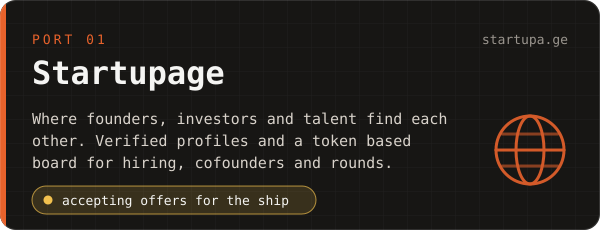</a>

<b><a href="https://startupa.ge">Startupage</a></b>: verified profiles and opportunities for founders, investors and talent. Open to acquisition offers.

</td>
<td width="50%" valign="top">
<a href="https://calally.com">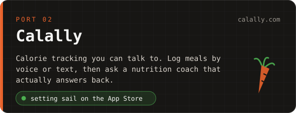</a>

<b><a href="https://calally.com">Calally</a></b>: log meals by voice or text and chat with a nutrition coach. iOS first.

</td>
</tr>
<tr>
<td width="50%" valign="top">
<a href="https://ciaobuilders.com">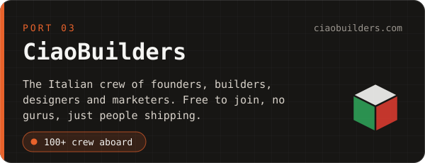</a>

<b><a href="https://ciaobuilders.com">CiaoBuilders</a></b>: the Italian community for founders, builders, designers and marketers.

</td>
<td width="50%" valign="top">
<a href="https://guglielmovaccaro.com">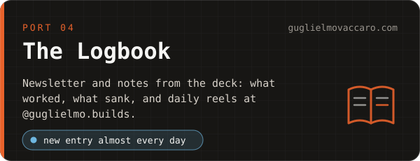</a>

<b><a href="https://guglielmovaccaro.com">The Logbook</a></b>: newsletter, notes and the honest numbers behind the projects.

</td>
</tr>
</table>

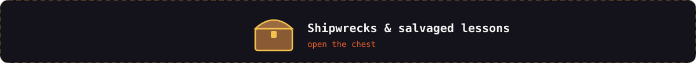

 

Every good sailor has a couple of wrecks behind them. These are mine, and I'd do them all again.

- **[Sp3llBound Studios](https://github.com/21BJ)**: indie game studio, shipped the mobile game **21BJ**. Lesson salvaged: a great product with no distribution is a message nobody reads.
- **Bitzuma**: Web3 magazine. Lesson salvaged: riding a wave is not the same as building a boat.
- **"Stupid things I did in my first startup"**: a whole reel series on [@guglielmo.builds](https://instagram.com/guglielmo.builds) about the mistakes, so you can skip them.

##  Rules Aboard

| Rule | Instead of |
| --- | --- |
| **Ship it** | polishing it forever |
| **Small crew** | big teams and bigger meetings |
| **Speed** | six months of planning |
| **Real problems** | "disruption" |
| **Revenue** | a term sheet |
| **Write me** | let's jump on a quick call |

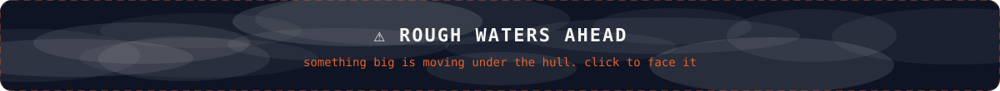

 

**The Kraken of Series A.** Weakness: revenue from day one, a tiny burn rate and shipping every single week. No board seats were harmed. The ship stays mine.

Want to sail the same way? <a href="https://ciaobuilders.com"><b>CiaoBuilders</b></a> is where Italian builders swap routes, tools and war stories.

##  The Rigging


##  FAQ

<b>Who is Guglielmo Vaccaro?</b>

 
An Italian startupper with a physics background who switched to startups more than five years ago. He builds <a href="https://startupa.ge">Startupage</a>, <a href="https://calally.com">Calally</a> and <a href="https://ciaobuilders.com">CiaoBuilders</a> from Rapallo, on the Ligurian coast.

<b>So are you a developer or a marketer?</b>

 
Neither, and a bit of both. Product, code, distribution, content: whatever the boat needs that day.

<b>Why no VC?</b>

 
Because I'd rather own a small boat than row someone else's galley. Bootstrapped, profitable as early as possible, free to change course.

<b>Can we hop on a call?</b>

 
Write me first at <a href="mailto:hello@guglielmovaccaro.com">hello@guglielmovaccaro.com</a>. A good message beats a 30 minute call nine times out of ten.

<b>What do you do when you're not building?</b>

 
BJJ on the mats, surf when the Ligurian sea allows it, mountains when it doesn't. And One Piece, obviously: still looking for the treasure.

##  Send a Signal

Fair winds. 🧭

